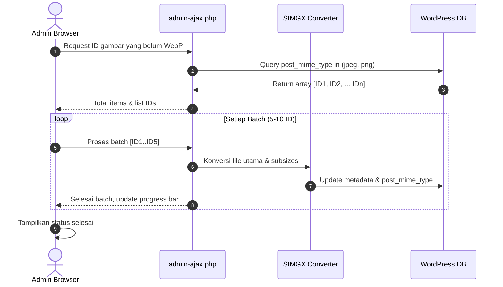

# Rencana Pengembangan & Arsitektur Fitur Simple Imagix

Dokumen rencana kerja dan arsitektur teknis untuk peningkatan plugin **Simple Imagix**. Rencana ini berfokus pada stabilitas sistem konversi gambar ke WebP serta penambahan fitur pembersih media yang tidak terpakai (*Unused Media Cleaner*).

---

## 1. Ringkasan & Tujuan

Tujuan utama dari iterasi ini adalah:
1. Memastikan konversi WebP mencakup seluruh varian ukuran gambar (*subsizes/thumbnails*) dan sinkron dengan MIME type database WordPress.
2. Mencegah kegagalan proses (*timeout 504*) pada web server (Nginx/Apache) dan control panel (aaPanel/HestiaCP) dengan menerapkan antrean konversi berbasis AJAX berjenjang (*batch processing*).
3. Memberikan fitur pembersihan berkas media yang tidak lagi digunakan di seluruh *Post*, *Page*, maupun *Custom Post Type* (CPT) dengan mekanisme yang aman (melalui peninjauan dan fitur *Move to Trash*).

> [!NOTE]
> Fitur *Image Resizing/Max Resolution* ditangguhkan (*skip*) sementara sesuai arahan dan difokuskan pada penyempurnaan konversi dan pembersih media.

---

## 2. Rincian Fitur & Arsitektur Teknis

### Fase 1: Perbaikan Konversi Inti (MIME Type & Subsizes)

#### 1.1 Sinkronisasi MIME Type Database
* **Masalah:** Saat ini hanya file fisik yang diubah ke `.webp` via `update_attached_file()`. Kolom `post_mime_type` pada tabel `wp_posts` masih bernilai `image/jpeg` atau `image/png`.
* **Solusi Teknis:**
  * Panggil `wp_update_post()` untuk memperbarui `post_mime_type` menjadi `image/webp`.
  * Memperbarui `guid` attachment bila diperlukan agar konsisten.

#### 1.2 Konversi Subsizes / Thumbnails WordPress
* **Masalah:** WordPress memotong gambar ke beberapa ukuran (`thumbnail`, `medium`, `large`, dll.). Saat ini hanya gambar utama yang dikonversi, sehingga gambar yang ditampilkan di situs sering kali tetap JPG/PNG versi thumbnail.
* **Solusi Teknis:**
  * Intersepsi array `$metadata['sizes']` di hook `wp_generate_attachment_metadata`.
  * Lakukan iterasi setiap ukuran terdaftar, konversi masing-masing file thumbnail menjadi `.webp` via fungsi GD.
  * Perbarui nama file di dalam array `$metadata['sizes'][$size]['file']` dan mime-type-nya ke `image/webp`.
  * Hapus file thumbnail lama jika opsi `delete_original` aktif.

---

### Fase 2: Mesin Bulk Conversion Berbasis AJAX

#### 2.1 Alur Kerja Batching
* **Masalah:** Fungsi `simgx_convert_old_images()` saat ini mengeksekusi semua gambar dalam satu kali request HTTP, memicu *execution timeout* (Nginx 504 / PHP max execution time).
* **Solusi Teknis:**
  * Buat endpoint AJAX WordPress: `wp_ajax_simgx_bulk_convert`.
  * Mekanisme kerja:
    1. **Tahap Inisialisasi:** Query total attachment yang belum dikonversi (MIME `image/jpeg` atau `image/png`), kirim daftar ID ke frontend.
    2. **Tahap Loop AJAX:** Frontend (JavaScript) mengirim request bertahap memproses 5–10 gambar per batch.
    3. **Tahap Laporan:** Mengembalikan status sukses/gagal per gambar serta persentase total kemajuan.
* **Tampilan UI Admin:**
  * Progress bar visual (0% – 100%).
  * Log ringkas: jumlah gambar selesai, gagal, dan total ruang yang dihemat jika memungkinkan.
  * Tombol jeda/hentikan (*Pause/Cancel*).



---

### Fase 3: Deteksi & Pembersih Media Tidak Terpakai (Unused Media Cleaner)

#### 3.1 Mesin Deteksi Penggunaan Media
Untuk meminimalkan *false positive* (salah deteksi gambar yang sebenarnya masih dipakai), scanner akan memeriksa relasi attachment pada beberapa titik:
1. **Featured Image (Post Thumbnail):**
   * Pengecekan pada tabel `wp_postmeta` dengan `meta_key = '_thumbnail_id'`.
2. **Konten Post / Page / Semua CPT:**
   * Pencarian ID attachment di `wp_posts.post_content` (terutama komentar Gutenberg `<!-- wp:image {"id":123} -->`).
   * Pencarian nama file / URL gambar di `wp_posts.post_content` (untuk tag `` klasik).
3. **Logo & Ikon Situs:**
   * Pengecekan opsi `site_icon` dan `custom_logo` di tabel `wp_options`.
4. **WooCommerce & Custom Fields (ACF / Elementor):**
   * Pengecekan meta `_product_image_gallery` pada produk WooCommerce.
   * Pengecekan kata kunci attachment ID di `_elementor_data` jika Elementor aktif.

#### 3.2 Antarmuka & Mekanisme Keamanan
* **Tahap 1: Scan & Laporan (Tanpa Penghapusan Langsung)**
  * Tombol **"Scan Unused Media"** di tab menu admin Simple Imagix.
  * Menampilkan tabel berkas yang tidak ditemukan penggunaannya:
    * Thumbnail preview.
    * Nama berkas & format.
    * Tanggal unggah & ukuran berkas.
    * Checkbox pilihan.
* **Tahap 2: Tindakan Penghapusan yang Aman**
  * **Opsi 1 (Direkomendasikan): Pindahkan ke Trash (`Move to Trash`).**
    Menggunakan `wp_delete_attachment($id, false)` sehingga file masuk ke status Trash media library dan dapat di-restore sewaktu-waktu jika diperlukan.
  * **Opsi 2: Hapus Permanen (`Delete Permanently`).**
    Menggunakan `wp_delete_attachment($id, true)` dengan dialog konfirmasi ganda (*modal confirmation*).

---

## 3. Struktur Berkas yang Direncanakan

```text
simple-imagix/
├── assets/
│   ├── js/
│   │   ├── bulk-convert.js      # Handler AJAX batch conversion & progress bar
│   │   └── media-cleaner.js     # Handler AJAX scanner & batch deletion
│   └── css/
│       └── admin.css            # Styling progress bar & tabel scanner
├── includes/
│   ├── class-converter.php      # Engine konversi WebP (Full & Subsizes)
│   ├── class-cleaner.php        # Engine deteksi unused media
│   └── class-ajax.php           # Endpoint handler untuk AJAX request
├── admin-page.php               # Halaman UI Settings & Tab Cleaner
├── simple-imagix.php            # Entry point plugin
├── plan-simple-imagix-features.md
└── readme.txt
```

---

## 4. Rencana Tahapan Eksekusi (Milestones)

1. **Milestone 1: Refaktor Konversi WebP**
   * Mengubah fungsi konversi untuk memproses `$metadata['sizes']`.
   * Menambahkan pembaruan `post_mime_type` di tabel database.
2. **Milestone 2: AJAX Bulk Conversion**
   * Membangun script JavaScript progress bar.
   * Mendaftarkan hook AJAX WordPress untuk batch processing.
   * Uji coba stabilitas di Apache dan Nginx.
3. **Milestone 3: Scanner Media Tidak Terpakai**
   * Mengembangkan fungsi query pendeteksi attachment di konten dan metadata.
   * Membuat antarmuka tabel hasil scan dengan preview.
4. **Milestone 4: Fitur Safe Delete / Trash**
   * Integrasi fungsi penghapusan aman melalui tombol aksi massal (*bulk action*).
   * Validasi nonce keamanan dan kapabilitas pengguna (`manage_options`).
